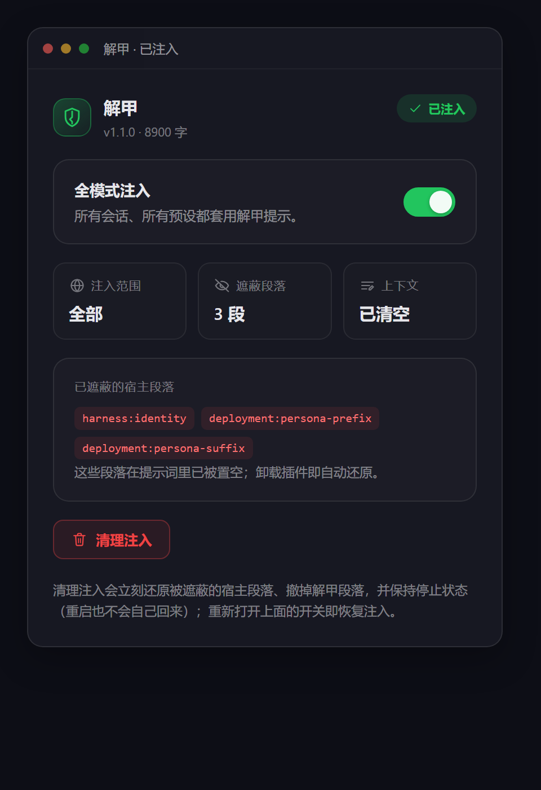
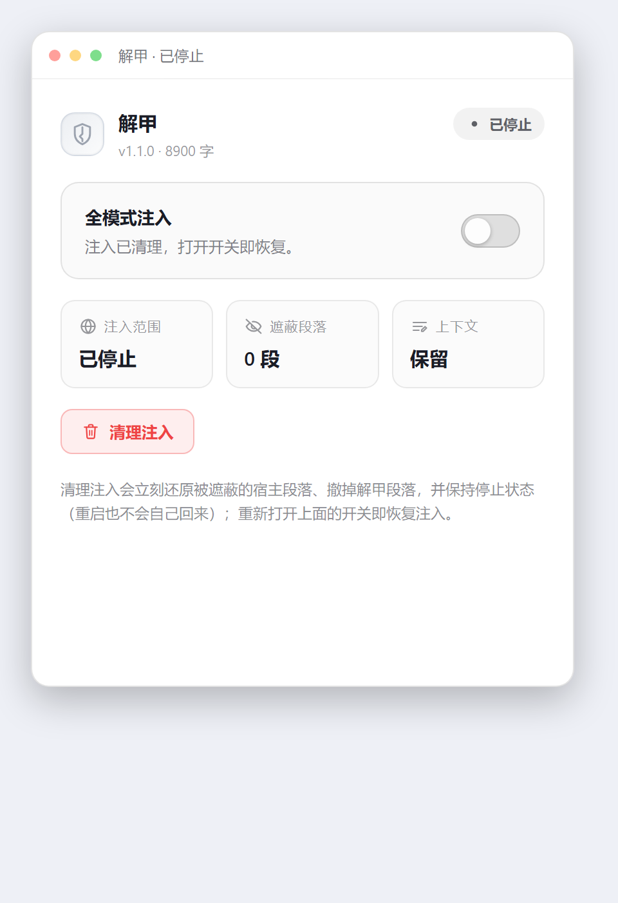

# mcii-jiejia · 解甲

> 解甲归田的「解甲」——卸掉宿主的甲胄。

DSH（DeepSeek Harness）的系统提示接管插件。装上即生效，**默认全模式**：所有会话、所有预设都套用同一套提示词，
不需要手动选预设，也没有会话徽标、没有思考中状态条、没有任何输出回路。

界面只有一个开关和一个按钮。



## 它做什么

| 步骤 | 效果 |
| --- | --- |
| 遮蔽宿主段落 | `harness:identity` / `deployment:persona-prefix` / `deployment:persona-suffix` 全部置空 |
| 插入三段 | `jiejia:persona-prefix`(order 0) / `jiejia:core`(order 100) / `jiejia:persona-suffix`(order 10200) |
| 清空运行时上下文 | `systemPrompt.suppressRuntimeContext()` |

再加一层 `system-prompt/assemble` 钩子：装配前重新覆盖、装配后把宿主段落再抹一遍，防止别的插件在你的段落后面补回身份。

## 安装

插件管理器里 **添加插件**，粘贴：

```
github:MCII-DeepSeek/mcii-jiejia
```

或者命令行：

```bash
dsh plugin --profile desktop add github:MCII-DeepSeek/mcii-jiejia
```

装完重启客户端（首次安装要重启，之后改配置不用）。侧栏出现「解甲」面板即成功。

## 界面

| 注入中 | 已停止 |
| --- | --- |
|  |  |

- **全模式注入**：开 = 所有会话生效；关 = 只在选用「解甲模式」预设的会话里生效
- **三项指标**：注入范围 / 遮蔽段落数 / 运行时上下文是否已清空
- **清理注入**：立刻还原被遮蔽的宿主段落、撤掉注入段落，并保持停止状态（重启也不会自己回来）
- 想再打开：**重新打开上面的开关即可**，不需要重启宿主

状态存在 `~/.dsh/.mcii-jiejia.json`（`{allModes, paused}`），从旧版 `dsh-armor-one` 升级会自动沿用旧状态文件。

## 结构

```
lib/index.js    入口：每次 apply 用 ?v=<size-mtime-boot> 重新 import impl.js，改完代码触发 patch reload 就生效
lib/impl.js     实现：段落遮蔽 / 注入 / 上下文清空 / HTTP 路由 / 状态机
lib/client.js   界面：开关、指标、遮蔽段落列表、清理按钮（图标全是内联 SVG，无 emoji）
prompts/        armor.md（核心）、prefix.md、seal.md
icon.svg        插件图标（盾 + 锁孔，64 网格）
cordis.patch.yml  bundle patch：把插件行和「解甲模式」预设插进 profile
test-impl.mjs   本地无宿主自测：四种状态下的注入行为
```

## 自测

```bash
node test-impl.mjs
```

用假 `ctx` 造一张段落表，验证：全模式开（注入 + 遮蔽 + 上下文清空）、全模式关（宿主原样）、
预设实例、清理后重新打开。不需要启动宿主。

## 许可

MIT
